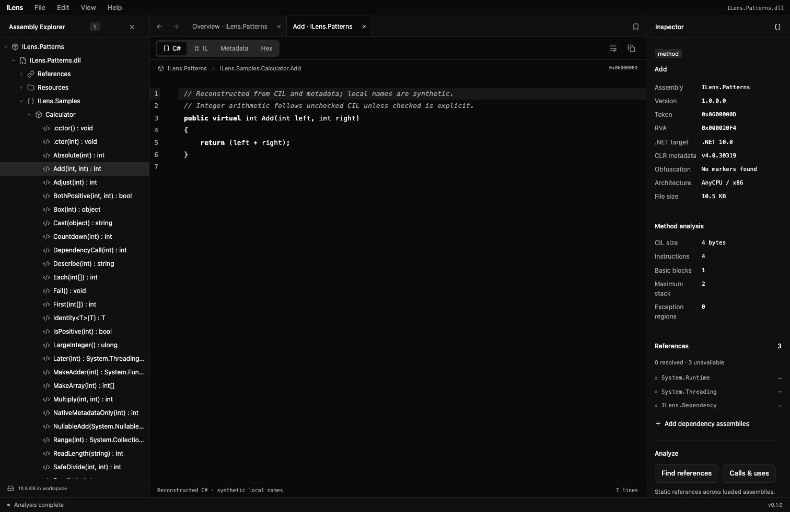
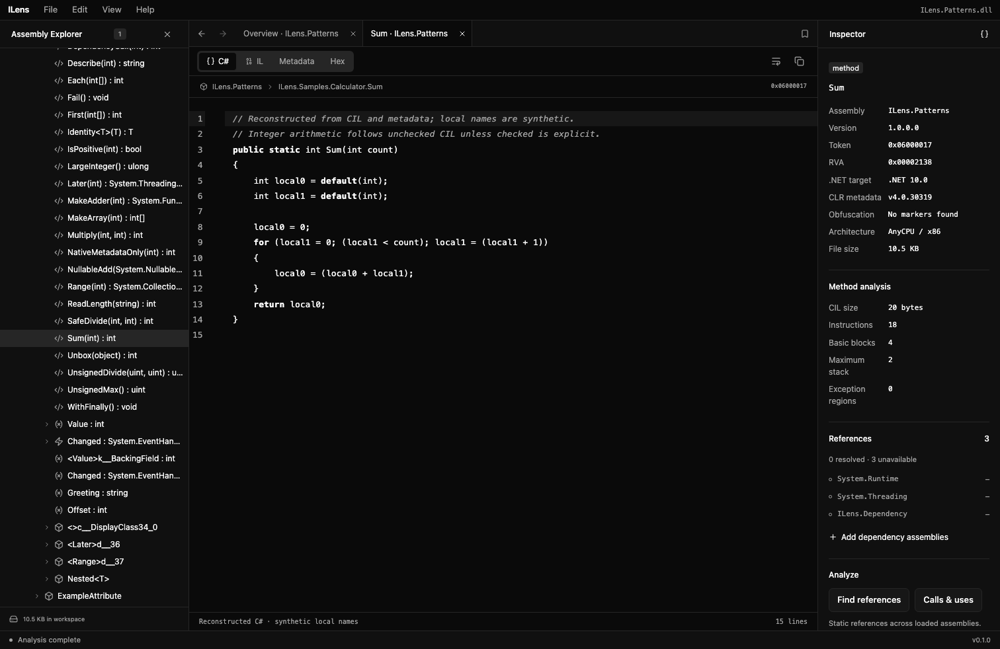
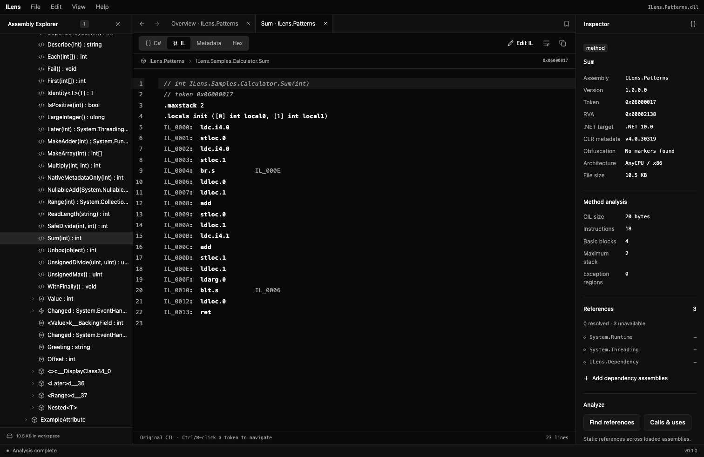
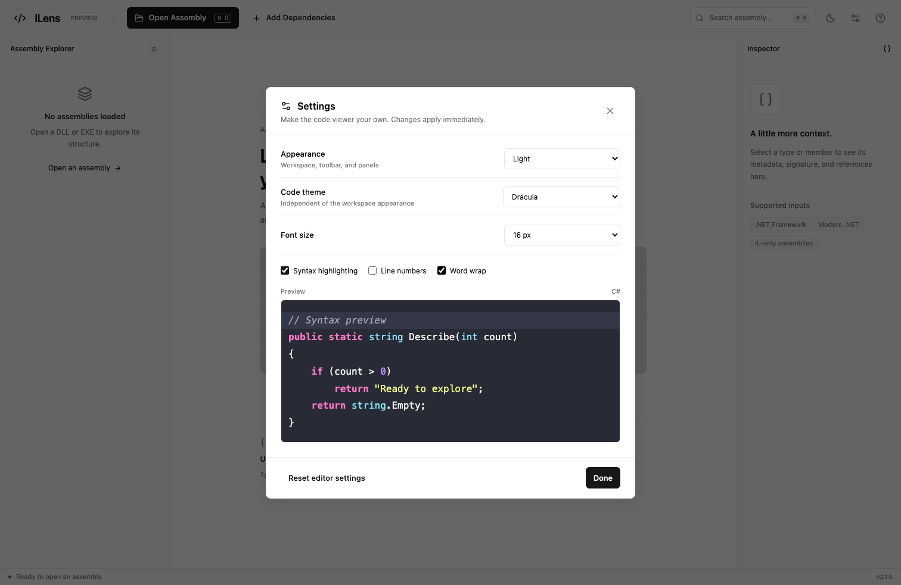
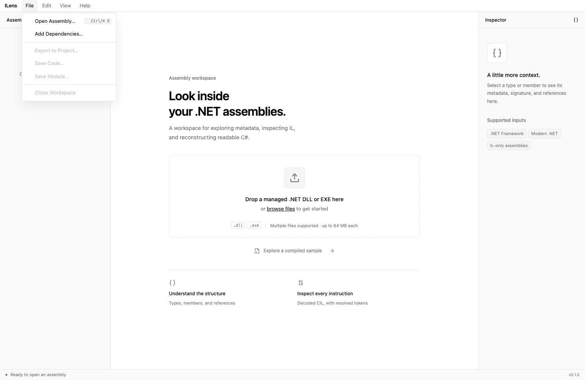
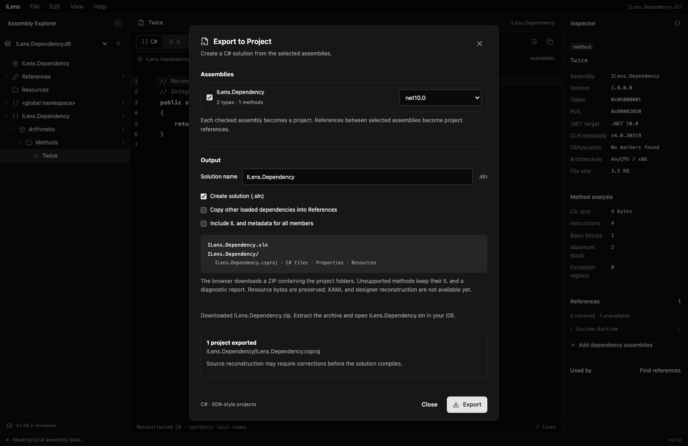
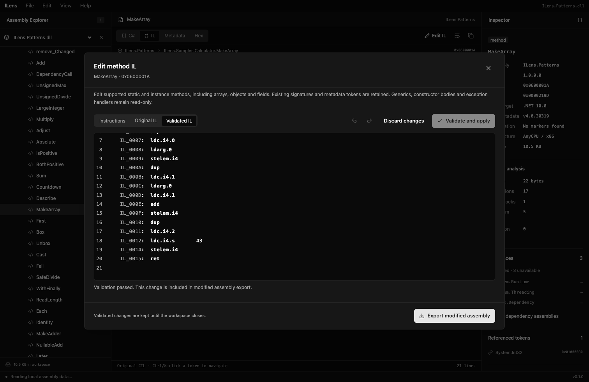
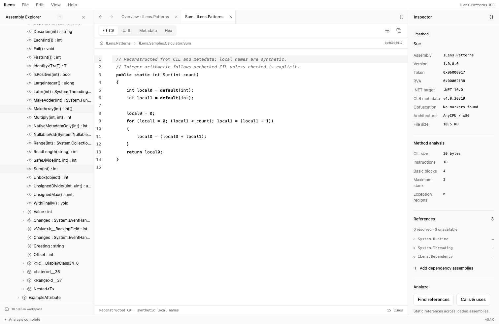
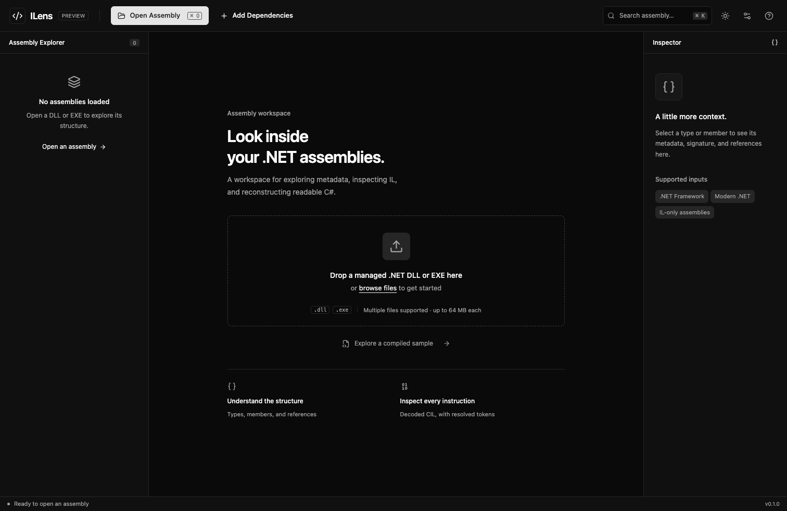
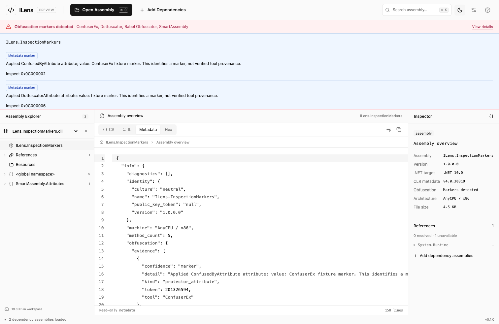

# ILens

[Open ILens in your browser](https://yusufgenc34.github.io/ILens/)

A browser-based .NET assembly explorer and decompiler. Open a managed DLL or EXE, browse its types and members, inspect CIL, and reconstruct readable C# for supported methods.

ILens uses **Rari, React, and TypeScript** for the interface and a **Rust WebAssembly core** inside a browser worker for static analysis. Assembly contents stay in the browser and are never executed.

This is an early decompiler release. Reconstructed code is not the original source; unsupported patterns fall back to annotated IL.

## Features

- Assembly → module → namespace → type → member explorer with direct member lists, signature labels, property/event accessors, virtualized rows, and keyboard navigation.
- dnSpy-style C# type views with usings, token comments, records, async/iterator methods, lambdas, local functions, pattern matching, string switches and other C# idioms; every sample's exported project compiles.
- Independent C#, IL, metadata, and raw-byte views with resolved metadata tokens.
- A whole-file hex editor linked to PE header offsets, a decoded metadata table viewer, and a docked Search window with kind filters.
- Local search across declarations, resource names and strings.
- All loaded assemblies in one Explorer, with reference navigation and exact assembly identity matching.
- Automatic dependency resolution when opening EXE/DLL files, using a selected folder and supported Microsoft .NET reference packs from NuGet.
- C# go-to-definition, document tabs, back/forward history and workspace bookmarks.
- Static Analyze results across loaded assemblies: callers, field reads/writes, derived types and interface implementations.
- Embedded resource inspection with text, hex, PNG previews and `.resources` v2 entry downloads.
- Declared .NET target and CLR metadata versions displayed separately.
- Obfuscator marker inspection with evidence and clearly labeled naming heuristics.
- Tailwind-based dark and light appearance, six code themes, syntax highlighting controls, and saved editor preferences.
- Bounds-checked parsing, structured diagnostics, cancellation, and explicit workspace cleanup.
- Project export with a Visual Studio solution, per-assembly C# projects, namespace folders, resources and project references.
- Separate method/type source downloads and inspection archives with IL and completeness reports.
- An IL editor with undo/redo and write verification for static/instance methods, constructors, generics, structs and managed pointers, exception regions, new string literals and locals, and external types from loaded dependencies; Add Field/Add Method with token renumbering; verified modified DLL/EXE downloads for supported unsigned assemblies.

## Quick start

Install Node.js **22.23.1** and Rust through [rustup](https://rustup.rs/). The repository selects Rust **1.92.0**, its WASM target, and formatting/linting components automatically. Running the app does not require .NET. Export verification tests and fixture regeneration require the .NET 10 SDK; ZIP conformance tests use Python 3.

```sh
git clone https://github.com/yusufgenc34/ILens.git
cd ILens
npm ci
npm run dev
```

Open [localhost:5173](http://localhost:5173). If you use nvm, run `nvm install` and `nvm use` to select the version in `.nvmrc`.

The first build installs the matching `wasm-bindgen-cli` and compiles the WASM core. It needs network access and may take several minutes. Generated bindings are placed automatically in `src/wasm`.

1. Choose File > Open Assembly or drag managed assemblies onto the application.
2. Select a type or method in the Assembly Explorer.
3. Switch between C#, IL, Metadata, and Hex.
4. Choose File > Set Dependency Folder to automatically resolve references from DLLs/EXEs in that folder and its subfolders. File > Add Dependencies still opens individual dependencies. Missing supported .NET references download automatically as soon as an EXE/DLL opens, and appear alongside it in Explorer. No reference click is required. Disable this in Edit > Settings when working offline.
5. Choose Edit > Settings to customize the code viewer.
6. Choose File > Export to Project to download a solution with one project per selected assembly. Use File > Save Code for individual source downloads.
7. Open the IL tab on a supported method and choose Edit IL, validate/apply changes, then File > Save Module to download the modified assembly.

Use `Ctrl/Cmd K` for metadata search, `Ctrl/Cmd F` inside the editor, and `Ctrl/Cmd`-click an underlined C# member or an IL metadata token to navigate. F12 follows a C# reference at the cursor; `Alt+Left` / `Alt+Right` walk navigation history. The bookmark button and View > Bookmarks keep useful declarations within the current workspace. Refreshing clears assemblies, folder access, tabs and bookmarks; editor preferences are retained.

## Docker Compose

Docker Engine/Desktop with Compose v2 is sufficient; host Node.js and Rust installations are not required.

```sh
docker compose up --build -d
```

Open [localhost:3000](http://localhost:3000).

```sh
docker compose ps
docker compose logs -f app
docker compose down
```

To use a different host port:

```sh
ILENS_PORT=8080 docker compose up --build -d
```

Optional settings are documented in [.env.example](.env.example). The default binding is loopback. For access through another host or an HTTPS reverse proxy, configure `ILENS_BIND_ADDRESS` and `ILENS_PORT` for your environment.

The multi-stage image compiles Rust/WASM and the Rari application, then runs the production server as an unprivileged user. Compose includes a health check, a read-only application filesystem, and a temporary `/tmp`. It requires no database, volume, credentials, or assembly storage. Docker serves the application; assembly analysis still runs in the browser.

## GitHub Pages

The hosted application is available at [yusufgenc34.github.io/ILens](https://yusufgenc34.github.io/ILens/). A separate static entry reuses the same React interface and browser worker; Rari remains the default development and Docker target.

```sh
npm run build:pages
npm run preview:pages
```

Open `http://127.0.0.1:4173/ILens/`. Pushes to `main` build, test, and deploy the Pages target through GitHub Actions. See [Pages setup and base paths](docs/github-pages.md) for forks, custom domains, and verification.

## GitHub Codespaces and Dev Containers

The included [.devcontainer configuration](.devcontainer/devcontainer.json) installs Node.js, Rust, and the WASM target, then prepares dependencies and bindings.

In GitHub, choose **Code > Codespaces > Create codespace**. In VS Code, use **Dev Containers: Reopen in Container**. After setup completes, run:

```sh
npm run dev
```

Open forwarded port **5173**. During development, port 3000 is Rari's internal backend. The application uses the forwarded origin and allows only the current Codespaces hostname. See [development notes](docs/development.md) for tooling, tests, and troubleshooting.

## Screenshots

These images show the running application analyzing the compiled C# fixture included in this repository.

### Assembly hierarchy



### Assembly explorer and reconstructed C#



### Original IL



### Editor settings



<details>
<summary>Source export and IL editing</summary>







</details>

<details>
<summary>Light appearance and start screen</summary>





</details>

<details>
<summary>Inspection warnings</summary>

The warning panel separates metadata evidence from heuristic findings. This capture uses the explicitly labeled marker test fixture, not a file protected by the named tools.



</details>

## Development commands

| Command | Purpose |
| --- | --- |
| `npm run dev` | Build WASM and start the development application on port 5173 |
| `npm run build` | Build WASM and the production application |
| `npm start` | Serve the production build on port 3000 |
| `npm run build:wasm` | Rebuild the Rust core and browser bindings |
| `npm test` | Run Rust and frontend unit/integration tests |
| `npm run typecheck` | Check TypeScript |
| `npm run lint` | Run frontend lint and Rust Clippy |
| `npm run format:check` | Check Rust formatting |
| `npm run test:e2e` | Test the development application in Chromium, Firefox, WebKit and phone emulation |
| `npm run test:e2e:firefox` | Run the Firefox project in a Linux Docker container against the running dev server |
| `npm run test:production` | Test the production application in the same browsers |
| `npm run fixtures` | Regenerate test DLLs using the .NET 10 SDK |

Install the browser once before browser tests:

```sh
npx playwright install --with-deps chromium firefox webkit
dotnet tool restore
npm run build:wasm
npm run test:e2e
npm run build
npm run test:production
```

To test a running Docker instance:

```sh
PLAYWRIGHT_BASE_URL=http://localhost:3000 npm run test:production
```

Stop a separately running server before tests that start their own server. GitHub Actions checks formatting, types, lint, native/worker behavior, browser styling, production builds, and the Docker application. The separate Pages workflow deploys the static site after its browser tests pass. No workflow publishes Docker images.

## Architecture

```text
React interface
  -> transferable assembly buffer
  -> dedicated browser worker
  -> Rust/WASM session and metadata index
  -> CIL -> control-flow graph -> stack analysis -> typed IR
  -> IR simplification -> AST -> C# emitter
       -> independent IL view
```

`decompiler-core` contains framework-independent parsing and analysis. `decompiler-wasm` exposes coarse operations through `wasm-bindgen`. Rari renders the shell and serves assets for the default target; the optional Pages entry renders the same interface entirely in the browser. Neither target receives assembly bytes on the server. Methods are analyzed on selection and recent results are cached.

| Directory | Contents |
| --- | --- |
| `src/app` | Rari routes, root layout, and global styles |
| `pages` | Static entry for GitHub Pages |
| `src/components` | Workspace, explorer, code viewer, and settings |
| `src/lib`, `src/workers` | Typed worker RPC and browser orchestration |
| `crates/decompiler-core` | PE/CLI parsing, metadata, CIL, analysis, and emission |
| `crates/decompiler-wasm` | Browser WASM interface |
| `samples`, `tests` | C# fixtures and Rust/frontend/browser verification |
| `scripts` | Required WASM and fixture build steps |
| `docs` | Architecture, security, research, and screenshots |

## Support and limitations

IL-only managed PE DLLs and EXEs are supported, including compatible .NET Framework and modern .NET assemblies. Metadata support covers generics, nested types, fields, methods, constructors, properties, events, attributes, P/Invoke declarations, references, resources, and exception regions.

A managed PE whose directory count omits a physically present CLR entry can be inspected when the standard header slot and metadata pass bounded validation. ILens reports the nonstandard layout and disables IL editing/binary rewriting for it. Input bytes remain unchanged; arbitrary packed or embedded assemblies are not recovered.

Common arithmetic, calls, fields, arrays, conditionals, loops, switches, and conservative try/catch/finally patterns can produce C#-like output. Complex async/iterator state machines, closure synthesis, nested exception patterns, and other unsupported constructs remain annotated IL. Some methods retain labels, gotos, or synthetic stack/local variables; output is intended for inspection and is not always standalone compilable source. Single-use copies and safe complete array initializers are simplified while preserving evaluation order. Loaded dependencies provide verified property semantics, so supported external accessors can appear as `.Text` or `.Text = value`. Missing definitions, indexers and unsupported signatures keep their original calls; names alone do not establish property semantics. See [source-readability rules](docs/architecture.md#source-readability-and-evaluation-order).

Ordinary ReadyToRun images can be inspected through their preserved metadata and CIL; native machine code is not decompiled and editing/rewriting is disabled. Composite ReadyToRun, NGen and mixed-mode inputs receive specific unsupported-format diagnostics. NativeAOT and native executables lack the CIL this decompiler needs. Native EXEs with Delphi/C++Builder VCL markers receive a diagnostic identifying those hints without claiming verified compiler provenance.

For potential .NET launchers without CLR metadata, ILens tries a same-named DLL from the selected files or dependency folder, refusing ambiguous matches. If the folder is selected after such an EXE failed, that EXE is retried automatically. A companion DLL is not assumed to exist for every native EXE. Single-file bundle extraction and renamed/custom apphost bindings are not supported; open their original managed DLLs. No local file is discovered outside files/folders you explicitly select.

WebCIL, PDB loading, type forwarding, and multi-module resolution are not implemented. Missing dependencies do not prevent inspection. Resolution checks loaded assemblies and the explicitly selected dependency folder first. Opening an assembly automatically downloads supported missing .NET references from fixed Microsoft NuGet reference packs when enabled; other packages are not guessed or fetched. Reference packs provide API metadata rather than method implementations. ILens does not scan system directories. See [workspace inspection](docs/workspace-inspection.md) for matching rules and limits.

Obfuscation detection recognizes selected metadata markers and naming heuristics. It is not a universal detector or deobfuscator; missing markers do not prove a file is unobfuscated. See [inspection rules](docs/assembly-inspection.md).

Source exports can be partial; generated solutions and projects are not guaranteed to compile, although every repository sample's export does. Unsupported constructs such as `fixed` statements stay in IL with a stated reason. IL editing covers static and instance methods, constructors and type initializers, generic methods and members of generic types, local structs, ref/out parameters and managed pointers, multidimensional arrays, try/catch/finally/fault regions, new `ldstr` literals and locals, and external classes, structs and enums when their assembly is loaded. Filter clauses, methods returning managed pointers, explicit-layout and generic structs remain read-only; new types and references cannot be added yet. Raw hex patches are checked for parseability but bypass IL verification. Binary output is restricted to supported unsigned x86/x64 managed PE layouts. See [export and editing support](docs/export-edit.md) for exact limits.

Browser tests run in desktop Chromium, Firefox and WebKit (Safari's engine), and a phone layout runs in Pixel 7 and iPhone 14 emulation. Select one engine with `npm run test:e2e -- --project=webkit`. Where Firefox cannot launch locally, `npm run test:e2e:firefox` runs it in Docker. On narrow screens the Assembly Explorer and Inspector become drawers, and a long press opens the declaration menu. Optional NuGet extraction also requires `DecompressionStream('deflate-raw')`; if unavailable, add dependencies locally. Use localhost HTTP or HTTPS; opening files through `file://` is unsupported. No browser extension, managed runtime, or shared-memory configuration is required.

## Documentation

- [Changelog](CHANGELOG.md)
- [Source export and IL editing](docs/export-edit.md)
- [IL write verification](docs/il-verification.md)
- [Design note: editing methods in C#](docs/csharp-editing.md)
- [Source export and assembly editing roadmap](docs/roadmap.md)
- [Architecture and worker API](docs/architecture.md)
- [Dependency folders, navigation, Analyze and resources](docs/workspace-inspection.md)
- [Development and container setup](docs/development.md)
- [GitHub Pages deployment](docs/github-pages.md)
- [Security model and resource limits](docs/security.md)
- [Framework and obfuscation inspection](docs/assembly-inspection.md)
- [Parser evaluation](docs/parser-evaluation.md)
- [mono-wasm study](docs/mono-wasm-notes.md)
- [Tailwind and Rari CSS integration](docs/css-loading.md)
- [dnSpy project export study](docs/dnspy-export-notes.md)
- [Performance notes](docs/performance.md)
- [Contributing](CONTRIBUTING.md)

## References

| Reference | Relevance to ILens |
| --- | --- |
| [Rari](https://rari.build/) and [official documentation](https://rari.build/docs/getting-started) | Application framework, routing, server components, and Vite integration |
| [migueldeicaza/mono-wasm](https://github.com/migueldeicaza/mono-wasm) | Historical reference for browser/WASM initialization, in-memory assembly loading, and memory ownership; no Mono runtime or source code is included |
| [ECMA-335](https://ecma-international.org/publications-and-standards/standards/ecma-335/) | CLI metadata, signatures, CIL instructions, and exception handling |
| [Microsoft PE format](https://learn.microsoft.com/en-us/windows/win32/debug/pe-format) | PE headers, sections, and address mapping |
| [.NET runtime opcode definitions](https://github.com/dotnet/runtime/blob/main/src/coreclr/inc/opcode.def) | Source of the checked-in opcode table; license attribution is preserved |
| [goblin](https://crates.io/crates/goblin) and [clrmeta](https://crates.io/crates/clrmeta) | Parser dependencies behind ILens's validation and metadata abstractions |
| [wasm-bindgen](https://wasm-bindgen.github.io/wasm-bindgen/) | Rust/JavaScript bindings and WASM memory ownership |
| [Tailwind CSS](https://tailwindcss.com/docs/installation/using-vite) | Utility-based interface styling, semantic theme tokens and Vite compilation |
| [CodeMirror](https://codemirror.net/) | Read-only code views, highlighting, and editor search |
| [dnSpy](https://github.com/dnSpy/dnSpy) | Workflow reference for source export and IL editing; its code is not embedded |
| [ILVerify](https://github.com/dotnet/runtime/tree/main/src/coreclr/tools/ILVerify) | Independent static verification of test fixture outputs; a test-only tool |
| [PKWARE APPNOTE](https://pkware.cachefly.net/webdocs/casestudies/APPNOTE.TXT) | ZIP32 archive format reference |
| [ILSpy](https://github.com/icsharpcode/ILSpy) | Reference for decompiler navigation and inspection workflows; ILens does not embed its decompiler |

## Legal use and disclaimer

ILens is intended for lawful software inspection, debugging, interoperability, and security research. You are responsible for ensuring that you have the legal right to inspect, decompile, modify, or redistribute the software you analyze, and for complying with applicable laws, licenses, and third-party rights. The project does not endorse unlawful use.

ILens is provided "as is", without warranties, under the [MIT License](LICENSE). To the extent permitted by applicable law, its authors and contributors disclaim liability for damages arising from use or misuse. This notice does not modify the MIT License or exclude liability that cannot legally be excluded.

## License

[MIT](LICENSE). Third-party code and generated opcode attribution are documented in [third-party notices](docs/third-party-notices.md).
