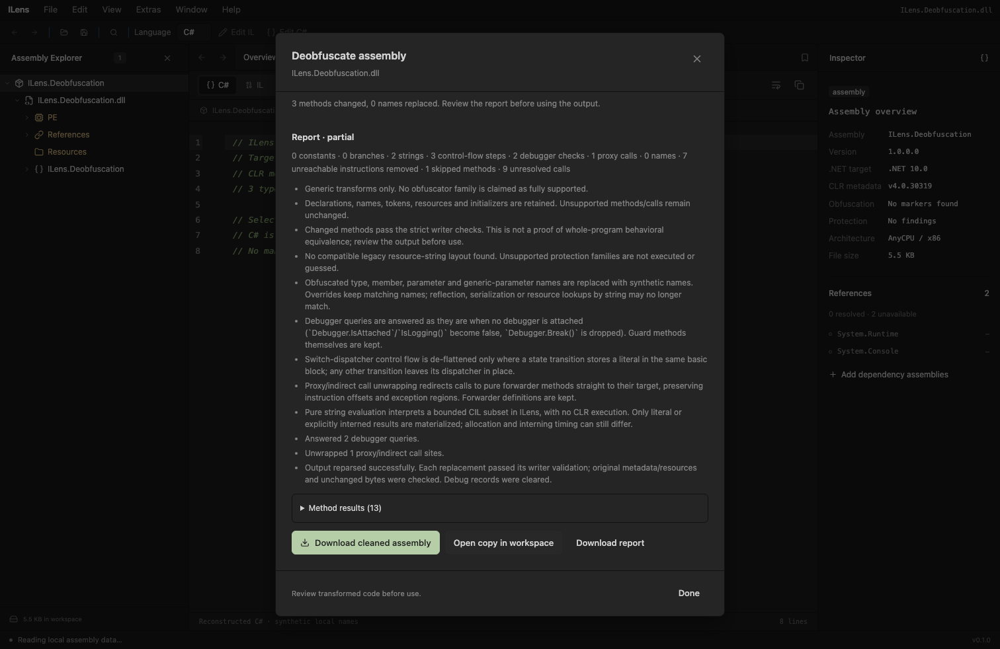
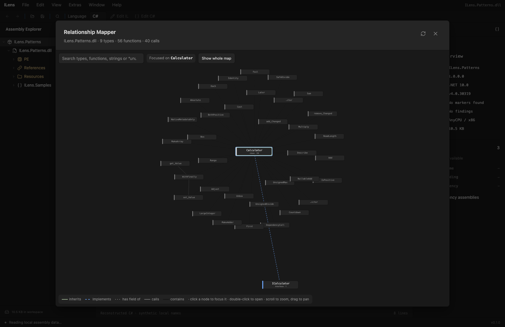

# Deobfuscation

This release implements D0 infrastructure, narrow generic D1 passes, and a static resource-string reader for one observed legacy Eazfuscator-compatible layout. It is not a complete de4dot port or a promise of support for every version of that family. Marker detection remains independent of cleanup capability.

## Use

1. Open an unsigned, supported managed DLL/EXE.
2. Choose **Extras > Deobfuscate (de4dot-style)** or **Fix it** on the obfuscation warning to run the default passes and open the cleaned copy directly. **Extras > Deobfuscation Options…** (also in the assembly/module context menu and the protection view) opens the dialog to pick passes first. The label describes the kind of cleanup; ILens does not include or run de4dot.
3. Select passes. Resource-string recognition, symbol renaming, proxy unwrapping, control-flow straightening, debugger answers, constant folding and branch simplification are enabled initially; pure helper evaluation has its own opt-in checkbox. Symbol renaming runs on top of whichever output the other passes produce. It, proxy unwrapping, debugger answers and the literal string writer also work where the general IL writer is unavailable (Field-RVA layouts, for one), in which case the whole-method IL transforms are dropped with a notice. A recognized resource-string profile takes a separate pass; generic transforms can be run on its output afterward.
4. Run the job and review the counts, per-method reasons and downloadable JSON report.

5. Download the output or choose **Open copy in workspace**. The original remains available; the copy is labeled in Explorer. A no-op run offers an explicitly unchanged download.

Use `samples/fixtures/ILens.Deobfuscation.dll` for a reproducible example. With string evaluation selected, `Message` resolves to `Hello ILens` and `Unicode` resolves to a non-BMP character. Negative examples remain intact and explain their limitations. The fixture is compiled from repository-owned source under `samples/Deobfuscation`; its I/O and initializer examples are never run through a runtime. It is not an output from a named obfuscator.

Pending method edits must be saved/reopened or discarded first. Workspace changes invalidate an active job. Cancelling or closing the dialog releases its pending output. The original assembly is not overwritten, and no download occurs until explicitly requested.

## Implemented passes

| Pass | Scope |
| --- | --- |
| Constants | Consecutive literal int32 arithmetic, bitwise, shifts and comparisons in one basic block; unchecked arithmetic wraps; operations that might throw are preserved |
| Branches | Literal conditional branches and bounded unconditional branch chains; no propagation across unknown block-entry values |
| Unreachable instructions | Instructions made unreachable by a verified transformation can be removed; declarations and metadata rows remain |
| Proxy/indirect calls | Calls to pure forwarder methods (a static method that only pushes its arguments in order and forwards them with one call/callvirt) are redirected to the real target; forwarder→forwarder chains resolve to the final target. Forwarder definitions are kept. Argument reordering, extra work, generics, varargs and delegate (`ldftn`) uses are not treated as proxies |
| Control flow | Switch-dispatcher de-flattening: where a state transition stores a literal in the same basic block, the transition branches straight to the block the dispatcher would have chosen, and the dispatcher is removed once nothing reaches it. A transition whose state is computed leaves its local live and its dispatcher untouched. Where the general IL writer is unavailable this runs as a same-size patch instead: the literal and the store become `nop`s and the branch that is already there is retargeted, keeping its opcode and width. That variant cannot straighten a transition that reaches its dispatcher by falling through, and it leaves the dispatcher in place, because removing it would move instructions |
| Debugger checks | `System.Diagnostics.Debugger.IsAttached` and `IsLogging()` are answered `false` and `Debugger.Break()` is dropped — the state the copy is actually read in. Each replacement is the same length as the `call`, so this also runs on layouts the general IL writer refuses. Guard methods are kept; the constant and branch passes fold the guard away on their own |
| Strings, opt-in | Direct same-module static nongeneric string-returning calls with consecutive literal int32/string arguments; only supported pure evaluation paths, with no required initializer |
| Rename symbols | Type, field, method, property, event, parameter and generic-parameter names containing invisible/control or non-identifier characters get synthetic names (`Form0`, `Class3`, `string_0`, `method_2`, `smethod_1`, `vmethod_0`, `Property_0`). Virtual methods, properties and events map each distinct obfuscated string to one name, so overrides and implicit interface implementations still match; accessors follow their property/event. Module-scoped TypeRefs, MemberRefs on own (generic) types and `Type.resources` names are updated with them. Only #Strings name cells change; tokens, signatures and bodies are verified unchanged |

For the whole-method IL passes (constants, branches, control flow, string evaluation), both the original and the changed method must pass the strict write verifier. That path skips exception-handling methods and methods above 2,000 instructions; renaming, proxy unwrapping, debugger answers and literal string replacement are separate same-size passes without those limits. Nothing here deletes members or helpers, removes initializers, unflattens a dispatcher whose state is computed, decrypts arbitrary resources, decompresses executable payloads, executes native code or unpacks protections. Signed, ReadyToRun, FieldRVA and other writer-incompatible layouts retain the existing writer restrictions; validation has not been loosened for this feature.

## Legacy resource-string profile

`deobfuscate/eaz.rs` recognizes a specific legacy decoder layout using structural CIL fingerprints plus metadata signatures, helper shapes, record flags and resource validation. Offsets identify expressions only after the complete layout matches. Resource names, assembly identity, metadata tokens, key literals and seeds are extracted from the input; no filename, assembly-specific key or decrypted application string is built into ILens. Other layouts are refused rather than interpreted through a runtime.

The reader handles per-record/shared keys, the supported byte cipher, bounded record redirects, Latin-1/UTF-16 and the layout's compressed string records. A closed integer-expression reader resolves key expressions and type-token constants from metadata. It does not invoke reflection or run initializers: scalar initializer expressions are read separately, reflection-dependent alternatives are kept as candidate seeds, and ambiguous records are rejected. Only interned, losslessly representable string results are emitted.

Each immediate `ldc.i4; call static string(int)` site becomes same-size `nop` bytes followed by `ldstr`. No branch or exception boundary may enter the replaced sequence, and prefixed calls are excluded. Stack input/output at the sequence boundary is preserved. Exception sections, local signatures, maxstack, instruction offsets and method RVAs remain byte-for-byte unchanged. This specialized writer does not require every unrelated instruction in a large protected method to be supported by the general IL editor.

Fixed-size primitive Field-RVA storage and empty explicitly sized value-type buffers are range-checked and protected from overlap. Unknown sizes, reference-containing layouts, aliases, signed/ReadyToRun images and unsupported PE layouts are rejected. General editing retains its existing Field-RVA restriction. The writer can create a missing `#US` stream and append strings while preserving every existing metadata row/token. Output reparsing, literal round-trips and original-byte checks precede publication.

This removes string encryption at supported call sites, not all protection. Names, helpers, initializers and original encrypted resources remain. Calls replaced by literals no longer trigger the decoder's initialization, guard and cache side effects. An analysis copy is not a guarantee of whole-program behavioral equivalence or restored original source. Nonconstant arguments and unsupported records stay as calls with report reasons.

| Resource-profile limit | Value |
| --- | --- |
| Input / methods | 16 MiB / 16,384 |
| Detection / job decoded instructions | 2,000,000 each |
| Embedded resource / record / decompressed output | 4 MiB / 1 MiB / 1 MiB |
| Aggregate decoding work | 32 MiB |
| Retained strings / pending patches | 8 MiB each |
| Cached strings / call patches | 16,384 / 100,000 |
| Redirect depth / key bytes / Field-RVA ranges | 16 / 1,024 / 1,024 |
| Scalar expression steps / call depth | 20,000 / 16 |

The string back-reference format has a maximum 66 output bytes per 2-byte pair; output length is checked before allocation, every source/distance is checked, and the loop is bounded by produced bytes. There is no generic archive or executable unpacker.

Owned tests use synthetic encrypted/compressed records and `samples/ResourceStrings` for Field-RVA storage, try/catch/finally, unchanged offsets, missing `#US`, invalid ranges and rejected patch boundaries. A privately supplied compatibility sample was also inspected locally: 3,645 distinct records and 15,015 direct calls across 1,509 methods decoded successfully, with no unresolved direct string calls. The input and decoded content are not distributed. This evidence covers that layout only, not every Eazfuscator version or all obfuscation on that input.

For local static diagnostics, `cargo run -p decompiler-core --example deobfuscate -- INPUT OUTPUT` runs the resource pass and writes a new validated file. It refuses to overwrite an existing output. It never loads the target into a CLR.

### Reference and licensing

The archived [de4dot repository](https://github.com/de4dot/de4dot), commit `b7d5728fc0c82fb0ad758e3a4c0fbb70368a4853`, was examined, particularly its [Eazfuscator implementation](https://github.com/de4dot/de4dot/tree/b7d5728fc0c82fb0ad758e3a4c0fbb70368a4853/de4dot.code/deobfuscators/Eazfuscator_NET). Its [license](https://github.com/de4dot/de4dot/blob/b7d5728fc0c82fb0ad758e3a4c0fbb70368a4853/LICENSE.de4dot.txt) is GPLv3 or later. No source translation, linked library, executable or runtime from de4dot is incorporated. ILens's independent Rust record reader and scalar extraction were checked against the supplied decoder's CIL and owned synthetic records. Dynamic de4dot paths that can invoke analyzed code are excluded.

## Array-backed decoders

A decoder that builds its text from a static byte or char array is resolved by the same
opt-in evaluation, extended with byte arrays, `ldtoken` + `RuntimeHelpers.InitializeArray`
reads of Field-RVA storage, `Convert.FromBase64String` and the `System.Text.Encoding`
singletons. Decoding is strict: malformed UTF-8, non-ASCII bytes for the ASCII encoding
and sloppy Base64 stop evaluation rather than produce the runtime's replacement
characters, and only interned results are written.

An assembly with such an array is in the Field-RVA layout the general IL writer refuses,
so the string pass falls back to the same-size literal writer there: `ldc.i4 K; call` or
`ldstr S; call` to a static `string(int)`/`string(string)` decoder becomes the decoded
literal in place, with instruction offsets, exception regions and Field-RVA data
unchanged. A decoder whose declaring type has an initializer is still refused, because
evaluating it would mean guessing state ILens never observed.

`samples/fixtures/ILens.ArrayStrings.dll` is the reproducible example.

## Packed assemblies

**Extras > Packed Assemblies…** lists the managed assemblies this file carries in its
embedded resources, with their identity, runtime, size and declaration counts, and opens
any of them into the workspace beside the host. Finding one is a read: the resource bytes
are parsed as a PE/CLI image exactly like a file you opened. Nothing is decompressed,
decrypted, unpacked or executed. A resource that starts like an executable but does not
parse is reported as unrecognized rather than guessed at — that is where a compressed or
encrypted payload shows up, and ILens has no generic unpacker. Scanning stops at 64 MiB
of resource bytes, 256 reported payloads and 16 MiB per payload.

## Optional evaluation model

`emulate.rs` uses int32 values, UTF-16 strings, aliased char arrays and null. It supports a small set of locals/arguments, stack operations, unchecked integer operators, conversions, comparisons, branches/switches, char-array accesses and same-module helper calls. Unknown opcodes or external calls return an unresolved reason. Arrays retain aliases inside the value model; bounds violations stop evaluation. UTF-16 is decoded directly from the user-string heap, without lossy conversion. Unpaired surrogates cannot be emitted by this initial string writer and leave the original call intact.

The complete external operation allowlist is:

- `System.String(char[])`, modeled as a value operation rather than invoking a target constructor.
- `string.ToCharArray()`, `string.Length`, and `string.Chars[int]`.
- `string.Concat(string, string)` and `string.Intern(string)`.
- `RuntimeHelpers.InitializeArray(Array, RuntimeFieldHandle)`, which copies the field's own Field-RVA bytes into a char or byte array and returns nothing.
- `Convert.FromBase64String(string)`, decoded strictly: no whitespace, no missing padding, no non-zero trailing bits.
- `Encoding.UTF8`, `Encoding.Unicode`, `Encoding.BigEndianUnicode` and `Encoding.ASCII` as modeled singletons, and `GetString(byte[])` on one of them. There is no replacement-character fallback: anything malformed stops evaluation.

Each operation requires the exact signature and recognized core-library assembly name, public-key token and neutral culture. These scope checks select modeled semantics; they do not cryptographically authenticate a DLL. There is no arbitrary BCL call bridge. Fields, reflection, I/O, P/Invoke, threads, dynamic loading, general object construction and CLR execution are absent. Helpers with a declaring type initializer or module initializer are refused. Initializers and anti-debug members are retained in the output.

Only literal or explicitly interned string results become `ldstr`; newly allocated non-interned results remain calls to avoid an obvious reference-identity change. Even supported substitutions are not a proof of whole-program equivalence: allocation failures, allocation timing and interning timing can differ. Review transformed IL before using an output. “Cleaned” does not mean safe to execute or fully deobfuscated.

## Jobs, output and budgets

The Rust session owns one revision-bound job. Each worker step processes one method, returning progress, then yields so cancellation can be handled. A stale step/cancel cannot affect a newer job. Unknown paths remain unchanged; fatal job errors discard pending edits and publish no output. The existing worker watchdog can terminate the worker if a synchronous operation stalls.

| Limit | Initial value |
| --- | --- |
| Input / methods per job | 16 MiB / 4,096 |
| Total decoded input instructions | 200,000 |
| Instructions per method/helper | 2,000 |
| String-helper attempts per method | 16 |
| Evaluation steps per method / job | 20,000 / 1,000,000 |
| Accounted cumulative evaluator allocation per method | 1 MiB |
| String/char-array length | 32,768 UTF-16 units |
| Call depth / arguments / locals / stack | 8 / 8 / 64 / 64 |
| Changed methods / accounted pending edits | 256 / 8 MiB |

Allocation accounting is a resource safeguard, not an exact upper bound on all transient Rust allocations. Parser, output, workspace and WASM limits still apply. The writer revalidates modified bodies and reparses the output, checking preserved metadata/resources. Metadata tokens and declarations stay stable; user strings are appended as needed. Changed output clears supported debug records through the existing writer; no-op output stays byte-identical and is not anonymized.

An opened output retains its metadata identity but receives a distinct workspace ID and `derived_from` provenance. Derived copies are excluded from canonical dependency resolution, even after the original closes. This prevents an analysis copy silently replacing another assembly's dependency. Input, output and report live in memory until released; they are not sent to a server or persisted automatically.

## Verification and follow-up

Rust tests cover pure UTF-16 calls, negative side effects/initializers, recursion/loop/allocation budgets, integer boundaries, branch joins, byte-identical no-op output, strict writing, snapshot isolation and job cancellation. Browser tests use the real worker/WASM for reports, cancellation, downloading, original/copy navigation and reopening the result. The Chromium download test also runs ILVerify on the repository-owned output; it does not run that assembly. Phone tests check dialog sizing and reachable controls.

Statically unreferenced members are reported — in the relationship map, by searching `unused` — and never removed. Absence of a static caller is not absence of a caller: reflection, serialization and external consumers are invisible to this scan, and removing a row would mean remapping every token that follows it.

Next stages require separate compatibility evidence. A complete metadata rebuild must remap signature blobs, table/coded indices, EH catch tokens, IL operands and entry points, with explicit handling for opaque custom data. Member removal needs more than absence of static xrefs. Family-specific synthetic tests only establish the tested algorithm; actual version/protection outputs are required before claiming family support. No de4dot source or runtime was incorporated into this implementation.

Relevant semantics include [signed CIL division](https://learn.microsoft.com/en-us/dotnet/api/system.reflection.emit.opcodes.div) and [String construction](https://learn.microsoft.com/en-us/dotnet/api/system.string.-ctor). See also [write verification](il-verification.md), [architecture](architecture.md) and [security limits](security.md).

## Relationship Mapper

**Extras > Function Mapper…** opens one thing: a map of the whole assembly, built from decoded CIL (nothing is executed). There are no lists or tabs in it.

Every declared type is a node — connected or not — showing its kind and member count.

- **Click a node to focus it.** Only that node, everything it connects to and (for a type) its own functions stay on screen, so a crowded map becomes the one relationship you asked about. Clicking a neighbour moves the focus; **Show whole map** or clicking empty space returns.
- **Search** filters the map by type name, namespace, function name, signature — and by the **string literals a function loads**, so searching a word from a message finds the code that uses it. Matches and their neighbours stay; everything else drops away.
- **Search `unused`** for the functions nothing in this assembly calls. That is as far as a static scan reaches: reflection, serialization and external callers are invisible to it, which is exactly why ILens reports these and never removes them.
- **Double-click** any node to open that type or function in the code view. Scroll zooms, dragging the background pans, dragging a node moves it.

| Edge | Meaning |
| --- | --- |
| inherits | base class |
| implements | interface implementation |
| has field of | the type stores a field of that type |
| contains | a type and one of its functions |
| calls | a call between two methods, drawn function-to-function when both are shown and otherwise aggregated to their declaring types; thickness follows how many distinct calls |

Call edges come from `call`, `callvirt`, `newobj`, `ldftn`, `ldvirtftn` and `jmp`, with generic instantiations mapped to their method. Limits: 65,536 methods, 500,000 call edges, 420 drawn nodes, 60 functions per expanded type, and the first 8 string literals per function for search.

## Where a string is used

Selecting a user string — from the Ctrl/⌘ K search, or any `ldstr` operand — opens it in the C# view with the literal followed by every method whose CIL loads it. On a deobfuscated copy this works on the decrypted text, so a message like a licence warning leads straight to the methods that show it.

Every loaded assembly is scanned. Methods in the literal's own module carry its token and are clickable; matches in other loaded assemblies are found by text, since a `#US` token means nothing outside its own module, and are listed with their assembly name rather than linked. Scanning is static and capped at 500 reported methods.

